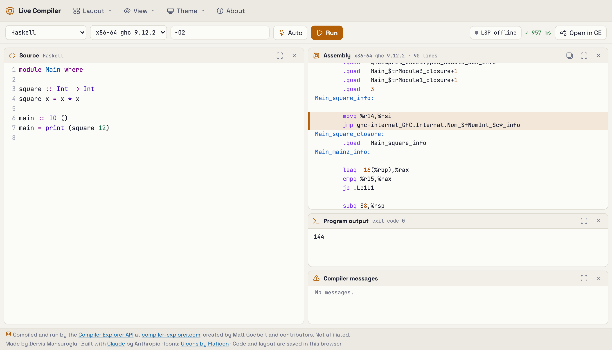

# Live Compiler

A code editor in a single HTML file that compiles as you type. It sends your code to the [Compiler Explorer](https://compiler-explorer.com/) API and shows the assembly, the program's output and the compiler's messages side by side, in panels you can resize, dock and hide.



## Features

- **Compiles as you type**, about 0.8 seconds after you stop (or straight away with Ctrl+Enter), and runs the program where the compiler supports it.
- **29 featured languages** with starter programs and default flags: C++, C, Rust, Go, Python, Zig, Swift, D, Nim, Haskell, OCaml, Fortran, Pascal, Ada, Kotlin, Java, Scala, C#, F#, Dart, Julia, Crystal, Ruby, Objective-C, CUDA, LLVM IR, assembly, Erlang and Elixir. Every other Compiler Explorer language is listed under "More on Compiler Explorer".
- **Source ↔ assembly links:** put the cursor on a line to highlight its assembly, or hover an assembly line to find its source.
- **A flexible layout:** drag a panel's title bar to dock it beside another or swap them, pick a preset, or hide panels. On narrow screens the panels become tabs.
- **Light, dark and system themes.** Your code, compilers, flags and layout are saved in the browser.
- **Open in Compiler Explorer** hands the current code and flags to compiler-explorer.com.
- **Optional IDE help** from real language servers on your own computer: completion, hover documentation, parameter hints and live error squiggles for Java, C, C++, Rust, Go, Haskell and Python.

## Quick start

There is nothing to install or build:

1. Download or clone this repository.
2. Open `app/index.html` in a browser.

You can also serve the `app` folder from any static web server. The page must be able to reach compiler-explorer.com, so sandboxed previews that block outside hosts won't work.

## Privacy

Your code is sent to compiler-explorer.com to be compiled and run, and to the language servers on your own computer if you run them. Nothing else leaves the browser. Your code, compiler choices, flags, layout and theme are kept in the browser's local storage.

## Code completion and live errors (optional)

The `lsp/` folder runs real language servers in Docker, one container per language, behind a small gateway that listens on 127.0.0.1 only. You build and run only the languages you want.

```sh
cd lsp
cp .env.example .env      # pick languages in COMPOSE_PROFILES, e.g. java,python
docker compose up -d --build
```

Then open <http://localhost:7998>: the gateway serves the app and connects it automatically. See [`lsp/README.md`](lsp/README.md) for the languages, the security model and troubleshooting.

Compiling still goes through Compiler Explorer; the containers only provide editor help.

## Project layout

| Path | What |
|---|---|
| `app/index.html` | The editor app (inline CSS and JS, libraries from cdnjs) |
| `lsp/gateway/` | The authenticating gateway; `public/index.html` is a copy of the app that it serves |
| `lsp/bridge/` | The stdio ⇄ WebSocket bridge that runs in every language container, plus per-language project templates |
| `lsp/languages/` | One Dockerfile per language server |
| `tests/e2e-lsp.mjs` | End-to-end test of the language-server path (Playwright) |
| `scripts/` | Static checks and the app → gateway copy |
| `docs/architecture/` | Architecture decision records (ADRs), the decision register and the architecture models |
| `CLAUDE.md` | Design notes and the project's rules, for Claude Code or any contributor |

## Development

```sh
npm run check     # syntax-check inline scripts and services, validate the compose file, check the gateway copy
npm run sync      # copy app/index.html to lsp/gateway/public/index.html; run after every app edit
```

[CONTRIBUTING.md](CONTRIBUTING.md) has the conventions and how to run the end-to-end test, which needs pyright and Playwright's Chromium.

## Status

**Tested:**

- Compiling, running and the source ↔ assembly links against the live compiler-explorer.com API.
- The language-server path end to end with pyright: the gateway and the bridge run as plain Node processes and Playwright drives the app in headless Chromium. This runs in CI.
- Layout docking, persistence and themes, in headless Chromium.

**Not tested yet:**

- **The Docker images.** None of them has been built yet. Known risks:
  - The Haskell image uses ghcup's "recommended" GHC and HLS, which might not match each other.
  - jdtls is an unpinned snapshot.
  - The gopls version may need bumping.
- **The other language servers with the app:** Java, Haskell, C, C++, Rust and Go.

Reports and fixes for any of these are very welcome.

## Using Compiler Explorer considerately

Compiler Explorer is a free service run by volunteers. The app waits for a pause in typing and cancels requests that are out of date, so it sends about one compile per edit. Please keep it that way in forks. If you find it useful, consider [supporting Compiler Explorer](https://github.com/compiler-explorer/compiler-explorer).

This project is not affiliated with Compiler Explorer.

## Credits

- Compiling and running by the [Compiler Explorer API](https://github.com/compiler-explorer/compiler-explorer/blob/main/docs/API.md) at [compiler-explorer.com](https://compiler-explorer.com/), created by Matt Godbolt and contributors.
- Editor: [CodeMirror 5](https://codemirror.net/5/).
- Icons: [UIcons by Flaticon](https://www.flaticon.com/uicons). Their licence requires the attribution in the app's footer.
- Fonts: JetBrains Mono and Space Grotesk, from Google Fonts.
- Made by Dervis Mansuroglu. Built with [Claude](https://claude.ai) by Anthropic.

## License

[GNU General Public License 3.0](LICENSE) (`GPL-3.0-only`), with one additional term under section 7(b): the "Made by Dervis Mansuroglu" credit must stay in the app's About dialog. See [ADDITIONAL-TERMS.md](ADDITIONAL-TERMS.md).

In short: you can use, change and share this code. If you distribute a changed version, you must offer its source code under the same licence. Hosting the app counts, because every visitor's browser downloads its code. The About dialog links to the source; if you host a changed copy, point that link at your own source.

CodeMirror, the icons and the fonts are loaded from their CDNs at runtime and aren't part of this repository; each is covered by its own licence.
