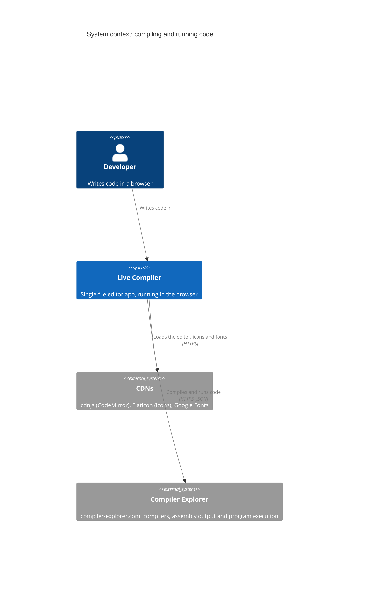

# ADR-0003: Compile and run code through the public Compiler Explorer API at compiler-explorer.com

| | |
|---|---|
| **Status** | Accepted |
| **Date** | 2026-10-21 |
| **Owner** | Maintainers (currently Dervis Mansuroglu) |
| **Area** | Compiler Explorer integration |
| **Requirements** | – |
| **Supersedes** | – (the use of godbolt.org predates the ADR process; see Context) |
| **Related** | [ADR-0001](0001-record-architecture-decisions.md) (conventions); [ADR-0004](0004-route-language-servers-through-a-localhost-gateway.md) (the language servers, which give editor help but don't compile); issue [#6](https://github.com/dervism/live-compiler/issues/6) (a smoke test against the live service) |

## Context

This ADR records a decision made before the ADR process existed.

Live Compiler's core feature is to compile code as you type and show the assembly, the program's output and the compiler's messages side by side, with assembly lines linked to the source lines they came from. It has 29 featured languages, and offers every other language Compiler Explorer supports: on 2026-10-21 that was 6,441 compilers across 98 languages.

The app is a single HTML file with no build step and no server of its own. It has to work when opened straight from disk.

[Compiler Explorer](https://github.com/compiler-explorer/compiler-explorer), an open-source project by Matt Godbolt and contributors, runs a free public service with a JSON [API](https://github.com/compiler-explorer/compiler-explorer/blob/main/docs/API.md). The API lists languages and compilers, compiles code with output filters, can run the program, and returns the assembly with a source line for each instruction. It allows cross-origin requests, so a page opened from disk can call it directly.

The app used the API at godbolt.org from the start. On 2026-10-21 it moved to compiler-explorer.com ([`6160931`](https://github.com/dervism/live-compiler/commit/6160931)). Before the move, compiler-explorer.com was checked: it serves the same site and API directly, without redirecting, with the same cross-origin headers, and its shortener returns `compiler-explorer.com/z/…` links.

Pages that block requests to outside hosts, such as published claude.ai artifacts, can't use the app at all.

## Decision drivers

1. Assembly linked to source lines, program output and compiler messages, for many languages and compilers.
2. No server and no build step of the project's own; the app works when opened from a file.
3. Nothing to install in order to compile.
4. Considerate use of a free community service.
5. Users know where their code goes.

## Options considered

### Option 1: The public Compiler Explorer API at compiler-explorer.com

- **Pros:** Thousands of compilers across nearly a hundred languages, kept up to date by the Compiler Explorer project. Assembly with source-line information, program execution and compiler messages in one call. Cross-origin requests are allowed, so no server of our own is needed.
- **Cons:** Needs an internet connection. Depends on a free service the project doesn't control. Users' code leaves their computer. Requests can be rate-limited.

### Option 2: The same API at godbolt.org (used until 2026-10-21)

- **Pros:** The service's best-known address.
- **Cons:** None technical: both addresses serve the same site and API. Choosing between them is a matter of naming, and the maintainer chose compiler-explorer.com.

### Option 3: A self-hosted Compiler Explorer in Docker

- **Pros:** Works offline, keeps code on the user's computer, and puts no load on the public service.
- **Cons:** Every user would have to install and run it, with many gigabytes of compilers. That breaks the "open the file and start" experience. (It remains an idea for an optional extra, like the language-server containers.)

### Option 4: Compilers running in the browser as WebAssembly

- **Pros:** Works offline and keeps code private.
- **Cons:** Only a few toolchains exist as WebAssembly builds, and they are large downloads. Most of the 29 featured languages, and the assembly and execution features, wouldn't be available.

### Option 5: Another public compile-and-run service

- **Pros:** Would spread the dependency beyond one service.
- **Cons:** It would have to match Compiler Explorer's range of compilers, its assembly output with source-line information, program execution and cross-origin access. The project depends on all of these.

## Decision

We will compile and run code through the public Compiler Explorer API at `https://compiler-explorer.com/api` (option 1).

- **The app uses four calls:**
  - `GET /api/languages?fields=id,name,defaultCompiler,example`
  - `GET /api/compilers/<lang>?fields=id,name,semver`
  - `POST /api/compiler/<id>/compile`, with `execute`, `intel` and the other output filters
  - `POST /api/shortener` for "Open in CE", falling back to a `/clientstate/<base64>` link
- **It uses the service considerately:**
  - It compiles about 800 ms after the last keystroke, or straight away on Ctrl+Enter.
  - A new compile cancels the one still in flight, using an `AbortController`.
  - The language list is fetched once per page load, and each language's compiler list once.
  - When the service answers HTTP 429, the app tells the user it is being rate-limited.
  - The app never retries a Compiler Explorer request or sends one on its own.
- **Users are told where their code goes:** the About dialog and the README say that code is sent to compiler-explorer.com.
- **The service is credited, and the project says it isn't affiliated:** the footer credits the Compiler Explorer API, Matt Godbolt and contributors, and says "Not affiliated".
- **The project calls the service Compiler Explorer or compiler-explorer.com,** not godbolt.org.

## Consequences

- **Positive:** The project runs no compile infrastructure, yet offers thousands of compilers that stay current. The app remains a single file that works from disk.
- **Negative:** The app needs an internet connection and works only while the public service is available. Code is sent to a third party, so the app doesn't suit confidential code. It can't run where outside hosts are blocked.
- **Risks and mitigations:**
  - The API changes or becomes restricted: the app uses only four documented calls, listed above and in CLAUDE.md, so it's quick to adapt. A self-hosted Compiler Explorer (option 3) is the fallback.
  - The public service is slow or down: the app shows a clear error ("can't reach compiler-explorer.com") and keeps the user's code.
  - The app or a fork puts too much load on the service: the request rules above are a project constraint that every ADR checks, and the README asks forks to keep them.
  - Changes to the API could go unnoticed, because the end-to-end test deliberately blocks outside hosts: an on-demand smoke test against the live service is tracked in [#6](https://github.com/dervism/live-compiler/issues/6).

## Architectural impact

- **Components:** the app (`app/index.html`).
- **Interfaces:** the Compiler Explorer API (the four calls above), and the links to compiler-explorer.com in the footer and the About dialog.
- **Quality attributes:** availability (it depends on the public service), privacy (code leaves the user's computer), performance (a compile and run takes about 0.5 to 1.2 seconds), and load on Compiler Explorer.
- **Diagram:** the system context.

## Validation

The integration is verified against the live service by compiling and running the starter programs, for example C++ with x86-64 gcc 16.2 (output `328350`) and Haskell with x86-64 ghc 9.12.2 (output `144`):

- the assembly lines link to their source lines in both directions;
- "Open in CE" receives a `compiler-explorer.com/z/…` link from the shortener;
- the app contacts no Compiler Explorer host other than compiler-explorer.com, and fetches the language list once per page load.

An on-demand smoke test that does this automatically is tracked in [#6](https://github.com/dervism/live-compiler/issues/6).

## Review trigger

- Compiler Explorer changes, restricts or starts charging for its API, or asks clients like this one to behave differently.
- Users often hit the rate limit.
- Users need to compile offline or keep their code private.
- The compiler-explorer.com address changes.

## Project constraints

- [x] The app stays one HTML file with no build step, and its libraries come from cdnjs only.
- [x] The editor still works when CodeMirror fails to load (the `<textarea>` fallback), and every icon keeps its Unicode fallback.
- [x] Compiler Explorer is used considerately: the 800 ms debounce and the AbortController stay, and nothing sends requests on its own.
- [x] The language-server security model holds: the gateway listens on 127.0.0.1 only and checks the token, the Host header and the Origin; language containers have no internet access.
- [x] The app never starts or controls containers.
- [x] The licence notices, the "Made by Dervis Mansuroglu" credit and the other footer credits stay.
