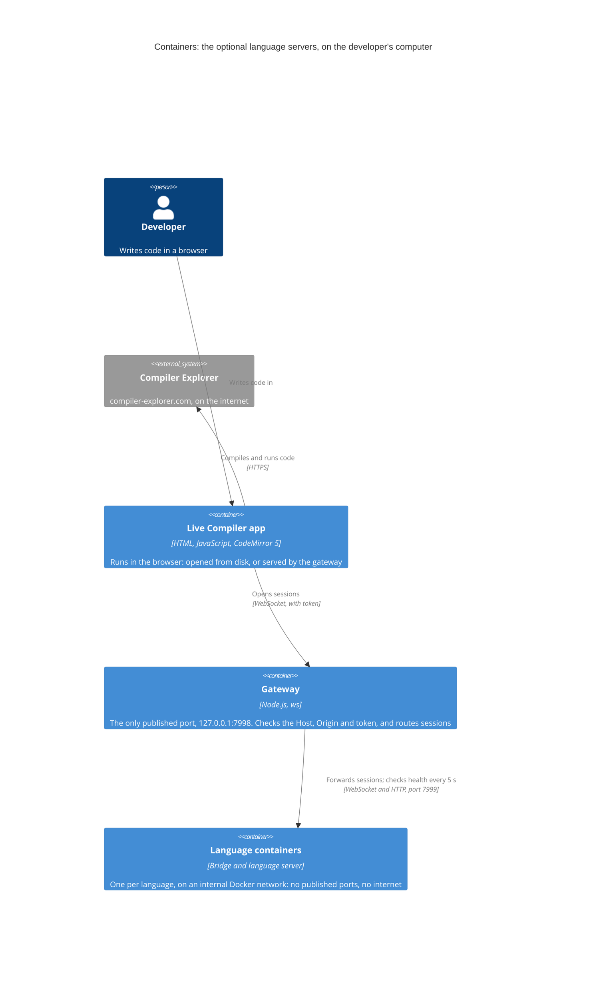

# ADR-0004: Route language-server sessions through one authenticating gateway on localhost

| | |
|---|---|
| **Status** | Accepted |
| **Date** | 2026-10-21 |
| **Owner** | Maintainers (currently Dervis Mansuroglu) |
| **Area** | Language servers |
| **Requirements** | – |
| **Supersedes** | – |
| **Related** | [ADR-0005](0005-run-language-servers-behind-a-bridge-one-container-per-language.md) (the language containers behind the gateway); [ADR-0003](0003-compile-through-compiler-explorer.md) (compiling, which doesn't go through the gateway); [SECURITY.md](../../../SECURITY.md); issues [#7](https://github.com/dervism/live-compiler/issues/7) (testing the rejections), [#8](https://github.com/dervism/live-compiler/issues/8) (the `NAMES` step in `lsp/README.md`), [#9](https://github.com/dervism/live-compiler/issues/9) (building the images) |

## Context

This ADR records a decision made before the ADR process existed. It was part of the project's first commit.

The app can optionally offer editor help: completion, hover documentation, parameter hints and live error squiggles. That help comes from real language servers running on the user's own computer in Docker containers, one per language ([ADR-0005](0005-run-language-servers-behind-a-bridge-one-container-per-language.md)).

- **Browsers can't talk to language servers directly.** Language servers speak the Language Server Protocol over standard input and output. A web page can only use HTTP and WebSocket.
- **Any website the user visits can try to reach local services.** A page can send requests to `localhost` from the user's browser, and DNS rebinding can make a hostile domain resolve to `127.0.0.1`. A local service that runs language servers, which read files and start processes, must not be usable by such pages.
- **The app runs from two kinds of address.** It may be opened from disk, where the browser sends `Origin: null`, or served by a local web server.
- **Languages come and go.** Users run only some of the language containers, and may start or stop them while the app is open. The app needs to know which ones are running, and why a connection failed.

## Decision drivers

1. Neither websites the user visits nor other machines can use the language servers.
2. The app has one address to connect to, whichever languages are running.
3. The app can tell which languages are running, and why a connection failed.
4. It works when the app is opened from disk.
5. The piece facing the browser is small enough to review, and has no control over Docker.

## Options considered

### Option 1: The browser connects to each language container directly

- **Pros:** No extra service.
- **Cons:** One published port per language. Every container would need its own token, Host and Origin checks. The app would have to know every port, and the attack surface grows with each language.

### Option 2: One gateway on 127.0.0.1 that authenticates and routes every session

- **Pros:** One published port and one token. The security checks live in one small file. The gateway can report which languages are running, and can serve the app itself.
- **Cons:** One more service and one more network hop. Users who open the app from disk must paste the token (only once, if `LSP_TOKEN` fixes it).

### Option 3: A gateway that also starts and stops containers

- **Pros:** Languages could start on demand, with no terminal needed.
- **Cons:** It would need the Docker socket, and control of Docker amounts to root access to the computer. A bug, or a website getting past the checks, would then reach the whole machine.

### Option 4: A standard reverse proxy, such as nginx or Caddy

- **Pros:** Mature, widely reviewed software.
- **Cons:** The health report across languages, handing the token only to same-origin pages, and the custom close codes would all need scripting or extra modules. Contributors would need to learn another configuration language.

### Option 5: A hosted language-server service

- **Pros:** Nothing for users to install.
- **Cons:** Users' code would go to yet another server. The service would cost money to run, and would have to be secured for the open internet.

## Decision

We will run one gateway, `lsp/gateway/gateway.js` (Node.js with the `ws` library), as the only container with a published port (option 2). It never controls Docker: the app's settings dialog shows the `docker compose` command for the user to run instead.

- **Address:** Docker Compose publishes the gateway on `127.0.0.1:7998` only (`LSP_PORT` changes the port).
- **Checks:**
  - **Host:** every request's `Host` header must be `localhost`, `127.0.0.1` or `[::1]`. This blocks DNS rebinding.
  - **Origin:** a WebSocket's `Origin` must be `null` (a page opened from disk), `http://localhost` or `http://127.0.0.1`, on any port.
  - **Token:** every WebSocket must carry the token, compared in constant time. The token is random on each start unless `LSP_TOKEN` sets it.
- **Endpoints:**
  - `GET /health`: which languages are running and which are known, plus session counts. Open to any origin and contains no secrets, because the app needs it even when opened from disk.
  - `GET /token`: the token, handed only to same-origin pages, meaning the copy of the app that the gateway serves. It sends no cross-origin headers, so other sites can't read it.
  - `GET /`: a copy of the app (`lsp/gateway/public/index.html`). `npm run sync` keeps it in step with `app/index.html`, and `npm run check` fails if it doesn't match.
  - `WS /lsp/<lang>?token=…`: forwarded to that language's container on port 7999.
- **Routing:** `UPSTREAMS` maps each language to its container; C and C++ share `lsp-clang`. The gateway polls each container's `/health` every 5 seconds.
- **Limits:** at most `MAX_SESSIONS` sessions (6 by default) across all languages, messages up to 8 MB, and 256 MB of memory.
- **Close codes the app understands:**

  | Code | Meaning | What the app does |
  |---|---|---|
  | 4401 | Bad token | Asks for the current token |
  | 4404, 4503 | The language isn't available, or its container isn't running | Tries again every 15 seconds |
  | 4408 | Closed after being idle (sent by the bridge) | Offers to reconnect |
  | 4429 | Too many sessions | Says so |
  | 1011 | The language server stopped | Points to the container logs; doesn't retry |

## Consequences

- **Positive:** One address and one token, whichever languages run. Websites the user visits can't use the language servers. The app can explain each failure. Adding a language takes only small changes to the gateway: an entry in its `NAMES` table and in `UPSTREAMS`.
- **Negative:** One more service to run and keep secure. Users who open the app from disk must paste the token, every time the gateway restarts unless `LSP_TOKEN` fixes it. The gateway's copy of the app has to be kept in sync.
- **Risks and mitigations:**
  - **`/health` is open to every website.** It reveals which languages are running and how many sessions are open, but no code and no token. That's accepted, because the app opened from disk needs it.
  - **`Origin: null` is also sent by sandboxed frames and other local files,** so the Origin check can't tell those apart from the app. The token is what stops them.
  - **The token travels in the WebSocket URL,** because browsers can't set headers on a WebSocket. The gateway logs only the language and the session counts, never the URL.

## Architectural impact

- **Components:** the gateway (`lsp/gateway`), the app's language-server client (`startLsp` and `LspClient` in `app/index.html`), and `lsp/docker-compose.yml`.
- **Interfaces:** the gateway's `/health`, `/token`, `/` and `/lsp/<lang>`, and its close codes; the language containers' `/health` and `/lsp/<lang>` on port 7999; the `LSP_TOKEN`, `LSP_PORT`, `MAX_SESSIONS`, `ALLOWED_ORIGINS` and `UPSTREAMS` settings.
- **Quality attributes:** security, privacy (code stays on the user's computer), and how reliably the optional editor help works.
- **Diagram:** the containers of the language-server setup.

## Validation

- The end-to-end test, `tests/e2e-lsp.mjs`, runs the gateway and a bridge as plain Node processes with pyright, and drives the app in headless Chromium. It checks the connection, completion, the documentation box, parameter hints, error squiggles, hover and the per-language settings, and runs in CI on every push and pull request.
- Tests for the rejections of bad tokens, hosts and origins are tracked in [#7](https://github.com/dervism/live-compiler/issues/7).

## Review trigger

- Browsers restrict web pages' access to `localhost`, for example with a permission prompt for local network access.
- A hosted copy of the app needs to use local language servers. That means adding its origin to `ALLOWED_ORIGINS`, which needs its own security review.
- Someone asks to use the language servers from another machine, or as a team.
- A security report concerns the gateway.

## Project constraints

- [x] The app stays one HTML file with no build step, and its libraries come from cdnjs only.
- [x] The editor still works when CodeMirror fails to load (the `<textarea>` fallback), and every icon keeps its Unicode fallback.
- [x] Compiler Explorer is used considerately: the 800 ms debounce and the AbortController stay, and nothing sends requests on its own.
- [x] The language-server security model holds: the gateway listens on 127.0.0.1 only and checks the token, the Host header and the Origin; language containers have no internet access.
- [x] The app never starts or controls containers.
- [x] The licence notices, the "Made by Dervis Mansuroglu" credit and the other footer credits stay.
