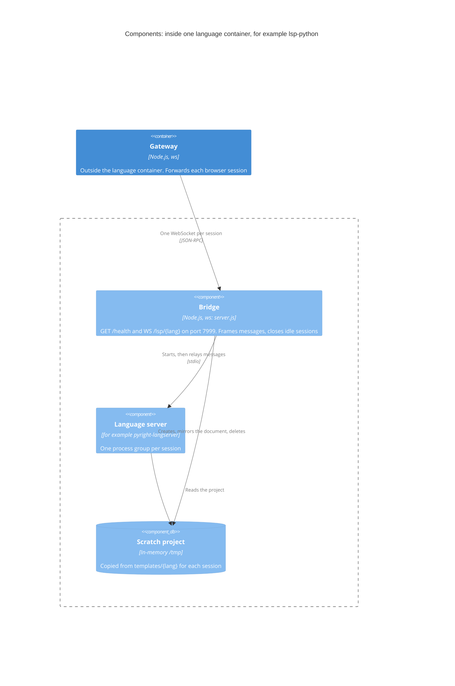

# ADR-0005: Run each language server behind a small bridge, in one container per language

| | |
|---|---|
| **Status** | Accepted |
| **Date** | 2026-10-21 |
| **Owner** | Maintainers (currently Dervis Mansuroglu) |
| **Area** | Language servers |
| **Requirements** | – |
| **Supersedes** | – |
| **Related** | Depends on [ADR-0004](0004-route-language-servers-through-a-localhost-gateway.md) (the gateway in front); [ADR-0002](0002-license-under-gpl-3.0-only.md) (the images would need the licence files if published); issues [#9](https://github.com/dervism/live-compiler/issues/9) (building and pinning the images), [#10](https://github.com/dervism/live-compiler/issues/10) (trying the other language servers) |

## Context

This ADR records a decision made before the ADR process existed. It was part of the project's first commit.

The gateway ([ADR-0004](0004-route-language-servers-through-a-localhost-gateway.md)) forwards each browser session over a WebSocket. Something behind it has to turn those messages into a running language server.

- **Language servers speak LSP over standard input and output,** with each JSON message preceded by a `Content-Length` header.
- **They expect a project on disk:** `Cargo.toml` for rust-analyzer, `go.mod` for gopls, `compile_flags.txt` for clangd, `hie.yaml` for haskell-language-server, `pyrightconfig.json` for pyright. Some read the source file from disk instead of only from the editor's messages.
- **The app edits one document per language,** and each browser tab opens its own session.
- **Toolchains differ wildly in size.** Rough image sizes run from about 0.4 GB for Python to about 4 GB for Haskell, and most users want only a few languages.

## Decision drivers

1. Users install only the languages they want.
2. Sessions don't interfere: they don't share files, and one crash doesn't end the others.
3. Sessions clean up after themselves.
4. Language servers can't reach the internet, and can only be reached through the gateway.
5. One small piece of code serves every language, so adding a language is mostly a Dockerfile and a project template.

## Options considered

### Option 1: One container per language, each running the same bridge, with a server process and a scratch project per session

- **Pros:** Install only what you use. Sessions are isolated from each other. One bridge for every language.
- **Cons:** Several images to build and maintain. Every session starts its own server, which takes time and memory.

### Option 2: One container with every language server

- **Pros:** One image and one service.
- **Cons:** About 9 GB to download, even for one language. All languages share one memory limit. Versions can't be updated independently.

### Option 3: One container per session, started on demand

- **Pros:** The strongest isolation between sessions.
- **Cons:** Something would have to control Docker to start the containers, which the project rules out ([ADR-0004](0004-route-language-servers-through-a-localhost-gateway.md)). Slow servers such as Eclipse JDT LS and haskell-language-server would start from scratch every time.

### Option 4: One shared server process per language, for every session

- **Pros:** Less memory, and faster connections after the first.
- **Cons:** Sessions would share a workspace and see each other's files. One crash would end every session. Cleaning up after a session would be harder.

### Option 5: An off-the-shelf WebSocket-to-stdio proxy

- **Pros:** Code the project doesn't have to maintain.
- **Cons:** It would still need the per-session scratch projects, the mirroring of the document to disk, the `bridge/ready` message and the `/health` report the gateway relies on. It would add a dependency to every image, while the bridge is about 150 lines.

### Option 6: Language servers compiled to WebAssembly, running in the browser

- **Pros:** No Docker at all.
- **Cons:** Few language servers have browser builds. Most need a native toolchain on disk: headers for clangd, Cargo for rust-analyzer, a JDK for Eclipse JDT LS, GHC for haskell-language-server.

## Decision

We will run every language server behind the same bridge, `lsp/bridge/server.js` (Node.js with the `ws` library), with one Docker container per language (option 1).

- **Containers:**

  | Container | Language server | Compose profiles |
  |---|---|---|
  | `lsp-python` | pyright 1.1.414 | `python` |
  | `lsp-go` | gopls v0.17.1 | `go` |
  | `lsp-clang` | clangd 18, for both C and C++ | `c`, `cpp` |
  | `lsp-java` | Eclipse JDT LS (latest snapshot) | `java` |
  | `lsp-rust` | rust-analyzer, from rustup | `rust` |
  | `lsp-haskell` | haskell-language-server and GHC, from ghcup ("recommended" versions) | `haskell` |

  Users choose languages with Compose profiles, on the command line or in `COMPOSE_PROFILES`; the `all` profile starts every container.
- **Images:** each Dockerfile begins with a shared stage that builds the bridge, then copies Node.js and the bridge into the language's official toolchain image. The build context is `lsp/`.
- **Isolation:**
  - Everything runs as an unprivileged user (uid 10001).
  - `/tmp` is a 2 GB in-memory filesystem.
  - Each container has a memory limit, from 1 GB (Python, Go) to 3 GB (Haskell).
  - The containers sit on the internal `lsp-internal` network: no published ports and no internet access.
  - An init process reaps finished child processes.
- **The bridge serves** `GET /health` (the languages it can run: those listed in `LSP_LANGS` whose server is installed and that have a template) and `WS /lsp/<lang>`, on port 7999. It has no authentication of its own; that is the gateway's job.
- **Each session:**
  1. Copies `templates/<lang>` into a fresh scratch folder.
  2. Starts the language server in its own process group.
  3. Sends `bridge/ready`, with the project's and the document's file URIs and the language id.
  4. Relays messages between the WebSocket and the server's standard input and output, adding and removing the `Content-Length` framing.
  5. Writes the document to disk 250 ms after the last change, for servers that read files.
  6. Closes with code 4408 after `IDLE_MINUTES` (30 by default) without messages.
  7. On close, sends SIGTERM to the whole process group, then SIGKILL after 3 seconds, and deletes the scratch folders. If the server exits or fails to start, the session closes with code 1011.

## Consequences

- **Positive:** Users download only the toolchains they use. Sessions can't see each other's files, and a crashing server ends only its own session. Adding a language follows a short recipe ("Adding a language" in `lsp/README.md`). The same bridge code runs everywhere.
- **Negative:**
  - Each session starts its own server, so the first completion can take a while, especially for Java and Haskell, and memory use grows with the number of sessions; `MAX_SESSIONS` caps it.
  - Without internet access, servers can't fetch dependencies, so only each language's standard library is available. Go runs with `GOPROXY=off`, for example.
  - Six images to keep up to date.
- **Risks and mitigations:**
  - **Toolchain versions may not fit together:** ghcup's "recommended" GHC and HLS might not match, Eclipse JDT LS is an unpinned snapshot, and the gopls version may need bumping. Pinning the versions and building the images in CI are tracked in [#9](https://github.com/dervism/live-compiler/issues/9).
  - **A language server misbehaves:** the process-group kill, the in-memory `/tmp`, the cleanup timers and the init process stop it from leaving processes or files behind.
  - **A language-server release breaks the app,** as pyright 1.1.390 did by going silent after startup: CI runs the end-to-end test with the same pinned pyright as the Python image; testing the other language servers is tracked in [#10](https://github.com/dervism/live-compiler/issues/10).

## Architectural impact

- **Components:** the bridge (`lsp/bridge/server.js`), the project templates (`lsp/bridge/templates/`), the language Dockerfiles (`lsp/languages/`) and `lsp/docker-compose.yml`.
- **Interfaces:** the bridge's `WS /lsp/<lang>`, its `bridge/ready` message and `GET /health`; LSP over standard input and output; the `LSP_LANGS`, `PORT`, `SESSIONS_DIR`, `IDLE_MINUTES` and `LOG_STDERR` settings; the Compose profiles.
- **Quality attributes:** security and isolation, memory use, start-up time, and how easy it is to add and update languages.
- **Diagram:** the components inside one language container.

## Validation

- The end-to-end test, `tests/e2e-lsp.mjs`, runs the bridge as a plain Node process behind the gateway, with pyright 1.1.414 (the same version as the Python image), on every push and pull request.
- Building the images, and trying the other language servers with the app, are tracked in [#9](https://github.com/dervism/live-compiler/issues/9) and [#10](https://github.com/dervism/live-compiler/issues/10).

## Review trigger

- The images are built, and the one-container-per-language setup causes problems.
- Memory use with several sessions open becomes a problem.
- A language needs packages from the internet to be useful.
- A language server gains a dependable browser build.

## Project constraints

- [x] The app stays one HTML file with no build step, and its libraries come from cdnjs only.
- [x] The editor still works when CodeMirror fails to load (the `<textarea>` fallback), and every icon keeps its Unicode fallback.
- [x] Compiler Explorer is used considerately: the 800 ms debounce and the AbortController stay, and nothing sends requests on its own.
- [x] The language-server security model holds: the gateway listens on 127.0.0.1 only and checks the token, the Host header and the Origin; language containers have no internet access.
- [x] The app never starts or controls containers.
- [x] The licence notices, the "Made by Dervis Mansuroglu" credit and the other footer credits stay.
